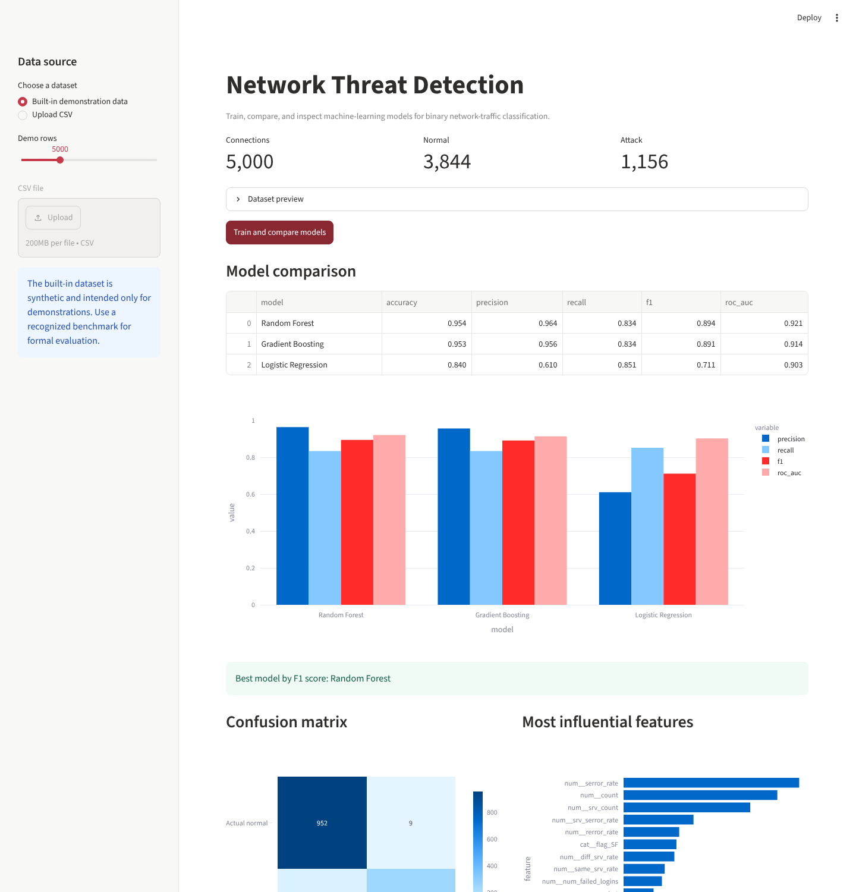

# Network Threat Detection

A reproducible machine-learning project for classifying network connections as normal or potentially malicious. The repository includes data validation, categorical preprocessing, model comparison, local inference, an interactive Streamlit dashboard, and a FastAPI prediction service.

The built-in dataset is synthetic and is provided so the full workflow can be run without downloading external files. It should not be treated as a benchmark result. For formal evaluation, upload a compatible dataset derived from NSL-KDD, UNSW-NB15, CICIDS, or another documented intrusion-detection dataset.

## Screenshots


*Model comparison, confusion matrix and feature importance*

## What this project demonstrates

- A complete scikit-learn preprocessing pipeline for numeric and categorical features
- Stratified train/test splitting and comparison of three classifiers
- Accuracy, precision, recall, F1 score, ROC-AUC, and confusion-matrix reporting
- Feature-importance inspection for the selected model
- Saved model artifacts for repeatable inference
- A Streamlit dashboard for training and individual connection analysis
- A FastAPI service with health, model-information, and prediction endpoints
- Automated tests, Docker support, and a GitHub Actions workflow

## Architecture

```text
CSV or demo data
      |
      v
Validation and schema checks
      |
      v
ColumnTransformer
  - numeric imputation and scaling
  - categorical imputation and one-hot encoding
      |
      v
Model comparison
  - Logistic Regression
  - Random Forest
  - Gradient Boosting
      |
      v
Evaluation and model selection
      |
      +--> Streamlit dashboard
      +--> FastAPI inference service
```

## Repository structure

```text
.
├── app.py                  # Streamlit dashboard
├── api.py                  # FastAPI service
├── train.py                # Command-line training entry point
├── src/
│   ├── data.py             # Demo data generation and validation
│   ├── inference.py        # Prediction contract
│   └── modeling.py         # Preprocessing, training, evaluation, persistence
├── tests/                  # Pipeline and inference tests
├── .github/workflows/      # Continuous integration
├── Dockerfile
├── docker-compose.yml
├── requirements.txt
└── pyproject.toml
```

## Run locally

Python 3.11 or later is recommended.

```bash
python -m venv .venv
```

Activate the environment, then install dependencies:

```bash
pip install -r requirements.txt
```

Train and save the best model:

```bash
python train.py
```

Start the dashboard:

```bash
streamlit run app.py
```

Start the API in a separate terminal:

```bash
uvicorn api:app --reload
```

API documentation is available at `/docs` while the server is running.

## Run with Docker

```bash
docker compose up --build
```

The dashboard is exposed on port `8501` and the API on port `8000`.

## CSV schema

Uploaded CSV files must include the columns defined in `src/data.py`, including the binary `label` field. Labels may be represented as `0/1` or `normal/attack`.

## Evaluation notes

The application selects the best model by F1 score. This choice emphasizes a balance between precision and recall, which is often more informative than accuracy for imbalanced security datasets. Results depend on the uploaded dataset and should be reported together with the dataset version, preprocessing decisions, and train/test methodology.

## Limitations

- The built-in data is synthetic and does not represent live network traffic.
- The project performs batch classification; it does not capture packets or inspect encrypted payloads.
- Feature importance indicates statistical influence, not causal explanation.
- Model output should support analyst review rather than automatically block traffic.

## Responsible use

This repository is intended for defensive security education and experimentation. Test only with data and systems you are authorized to use.

## Possible extensions

- Add adapters for NSL-KDD, UNSW-NB15, and CICIDS datasets
- Add probability calibration and threshold tuning
- Track experiments with MLflow
- Add drift and data-quality monitoring
- Add authenticated API access and rate limiting for deployed environments
- Add packet-flow ingestion from an approved lab environment
